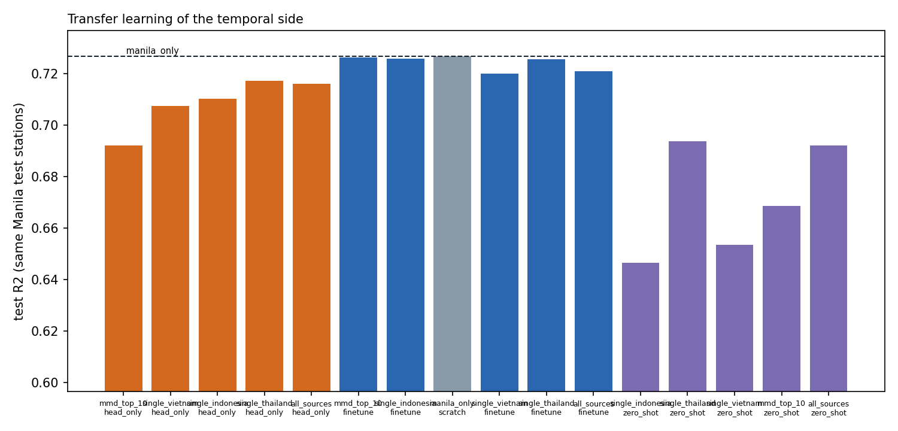

# Transfer learning of the temporal side: results, why it did not help here, and why these tests

This file is the stand-alone write-up of the transfer-learning experiment (other Southeast Asian capitals → Manila). The same results are also in the main [README.md](README.md) (section "The study in order", step F, and
section 2.20); this file adds the reasoning and the sources. Files for the figures are in [docs/transfer_learning/](docs/transfer_learning/) (`transfer_comparison.csv`, `transfer_comparison.png`, `transfer_progress.json`).

**In one paragraph.** An LSTM-only model was pretrained on PM2.5 from other cities (Bangkok, Jakarta, Hanoi, Ho Chi Minh City; Kuala Lumpur gave no usable windows) and then fine-tuned on Manila. Compared with the same model trained
only on Manila, **no pretrained pool improved accuracy beyond noise** (best cross-validated gain +0.0007 R², test R² 0.0005 to 0.0067 *lower*). So in this setup transfer learning is **not applicable as an improvement**:
Manila already has enough data of its own for the temporal model. That is a finding, not a failure, and the sections below say why we expect it and what the tests were chosen to show.

---

## 1. What was done

- **Model:** the LSTM-only variant of the dual-branch network (the CNN branch is off, because the four-model comparison and the learning curve showed it adds no accuracy). Input: the station's last three hours of PM2.5, the spatial
  lag (inverse-distance-weighted mean of the five nearest stations of the same city), and the hour of day. No weather, no morphology.
- **Pretraining:** on the source cities' PM2.5, scaled with **Manila's** scalers, with early stopping on held-out *source stations*.
- **Fine-tuning and scoring:** on the Manila training stations; scored on the **same 16 Manila test stations** as every earlier result (fixed in `configs/pinned_partition_2026-11.json`).
- **Pools** (what was pretrained on): `manila_only` (nothing, the control), `single_indonesia` (Jakarta, 5 stations), `single_thailand` (Bangkok, 125), `single_vietnam` (Hanoi + Ho Chi Minh City, 12),
  `mmd_top_10` (the 10 stations closest to Manila by maximum mean discrepancy; all in Bangkok), `all_sources` (every kept station). Which stations were kept and why: README.md, section 2.20, "Which source stations are used, and why not all of them".
- **Variants** (how a pool is used): `finetune` (start from the pretrained weights, train everything on Manila), `head_only` (the pretrained LSTM frozen, only the fusion head trained), `zero_shot` (the pretrained weights as they are, no Manila training).
- **How the winner is chosen:** by **3-fold spatial cross-validation on the Manila training stations** (the same folds for every pool); the test stations are looked at once, afterwards.

## 2. Results

Run on Kaggle, 20 to 22 November 2026 (`transfer_learning.ipynb`, `USE_CV = True`). CV R² = out-of-fold R² on the Manila training stations. "Folds won" = in how many of the 3 folds the pool beat `manila_only`.

| pool (pretrained on) | `finetune` CV R² | `finetune` test R² | folds won | `head_only` test R² | `zero_shot` test R² |
|---|---|---|---|---|---|
| `manila_only` (nothing) | 0.7174 | 0.7267 | n/a | n/a | n/a |
| `single_indonesia` (Jakarta, 5 stations) | 0.7173 | 0.7258 | 1 of 3 | 0.7102 | 0.6465 |
| `single_thailand` (Bangkok, 125) | 0.7177 | 0.7257 | 2 of 3 | 0.7173 | 0.6937 |
| `single_vietnam` (Hanoi + HCMC, 12) | 0.7174 | 0.7200 | 1 of 3 | 0.7075 | 0.6534 |
| `mmd_top_10` (closest 10, all Bangkok) | 0.7172 | 0.7262 | 1 of 3 | 0.6920 | 0.6686 |
| `all_sources` (every kept station) | 0.7181 | 0.7209 | 3 of 3 | 0.7161 | 0.6922 |
| `single_malaysia` | not run: Kuala Lumpur's two stations never report at the same time, so no window exists | | | | |

Previous-hour baseline (repeat the last value): R² 0.646, RMSE 6.08. Test RMSE of `manila_only`: 5.35 µg/m³.

Per-fold cross-validation R² (the three folds are the same for every pool):

| | fold 0 | fold 1 | fold 2 |
|---|---|---|---|
| `manila_only` | 0.7288 | 0.7417 | 0.6820 |
| `single_thailand` finetune | 0.7295 | 0.7430 | 0.6810 |
| `all_sources` finetune | 0.7294 | 0.7431 | 0.6822 |

**Reading**
1. **Nothing beats training on Manila alone.** The largest cross-validated gain is `all_sources` at +0.0007 (3 of 3 folds), with a test R² 0.0058 lower. Pools differ from `manila_only` by about 0.001 in each fold, while the folds themselves
   range from 0.68 to 0.74: the differences between pools are tens of times smaller than the difference between folds, so they are noise.
2. **Freezing the pretrained LSTM is worse in every pool** (0 of 3 folds each; test R² 0.692 to 0.717). The Manila hours still carry something the source cities do not.
3. **Without any Manila training, Bangkok-based models reach R² 0.69**, above repeating the previous hour (0.646) and below Manila-only (0.727). Jakarta and Vietnam pools stay at the previous-hour level. Some temporal behaviour transfers,
   but Manila's own data already supplies all of it.
4. **The similarity ranking did not pick a better pool.** `mmd_top_10` is no better than `single_thailand`, and its zero-shot score (0.669) is below Bangkok's (0.694).
5. **Source sizes differ a lot:** 106 training stations for Bangkok, 4 for Jakarta, 9 for Hanoi and Ho Chi Minh City, 120 for `all_sources`.

## 2b. What the three variants do (and how to explain them)

A pretrained pool can be used in three ways (`VARIANTS` in `transfer_learning.ipynb`). They form one dial, from trusting the source completely (`zero_shot`) to using it only as a starting point (`finetune`).

| Variant | What happens | In the code |
|---|---|---|
| `finetune` | Start from the pretrained weights and train everything on Manila. This is the usual transfer. | `train.init_from` = the pretrained model |
| `head_only` | Start from the pretrained weights, **freeze the LSTM** so it stays exactly as the source cities left it, and train only the final layer (the fusion head) on Manila. | `train.freeze = ["temporal"]` |
| `zero_shot` | Load the pretrained weights and **do not train them on Manila at all**: one pass with learning rate 0, so no weight moves, then score on the Manila test stations. | `train.final_epochs = 1`, `train.optimizer.lr = 0` |

In plain words:
- **`zero_shot`:** "We take the model that learned only from other cities and test it on Manila with no Manila training. It shows how much knowledge carries over without any Manila data."
- **`head_only`:** "We keep what the other cities taught the LSTM and let Manila adjust only the last step. It shows whether the LSTM's learned patterns are general enough to use as they are."
- **`finetune`:** "We start from the other cities' knowledge and let Manila adjust all of it. It shows whether starting from there beats starting from scratch."

What the results mean:
- **`zero_shot`:** Bangkok-based pools reach test R² 0.69, above repeating the previous hour (0.646) and below Manila-only (0.727); Jakarta and Vietnam stay at the previous-hour level. Some temporal behaviour carries over, but not enough alone.
- **`head_only`:** worse than Manila-only in every pool (test R² 0.692 to 0.717 against 0.727; 0 of 3 folds won). A frozen LSTM cannot adjust to Manila, so what the other cities taught it is not enough for Manila.
- **`finetune`:** equal to Manila-only. Once the LSTM can retrain on Manila's data, the pretraining adds nothing beyond noise.

Accuracy rises as the model is allowed to adapt more to Manila. That is the pattern when the source adds little that Manila's own data does not already provide.

A caveat if a panelist asks: `zero_shot` and `head_only` also use the pretrained final layer and the Manila-fitted scalers, so they test the whole pretrained model, not the LSTM in isolation.

## 3. Why transfer learning is not applicable here

This section is interpretation. Items 3.1 to 3.3 are supported by the numbers above; each also names the literature that explains the expectation. None of it is a proof, and 3.5 says what the experiment does *not* show.

**3.1 The target is not data-scarce.** Transfer learning is built for the case where the target has too little data to learn well: Pan and Yang's survey defines it as improving learning in a target domain with the help of a source domain
because target data is limited (Pan and Yang, 2010), and the air-quality studies that report gains evaluate sparse target sites or small target-data budgets (Wei, Zheng and Yang, 2016, cities with few labelled stations; Yang et al., 2023,
sites with sparse data; Vrbančič et al., 2026, six target-data budgets). Here the Manila training set has 68 stations and about 1.06 million training samples. A study of pretraining in computer vision found that pretraining mainly speeds up early
training and that, with enough target data and training time, a model trained from scratch reached the same accuracy (He, Girshick and Dollár, 2019). Our learning curve points the same way: LSTM-only R² is 0.716 with 20 Manila training
stations and 0.724 with 67, so there is little to gain even by adding more *Manila* data (README.md 8.5).

**3.2 The sources differ from Manila.** The theory of learning from different domains bounds the target error by the source error plus a term for how far apart the two distributions are (Ben-David et al., 2010): sources that look different
cannot be relied on to help. The mean PM2.5 of the stations is 18.9 µg/m³ for Manila's training and calibration stations (67 with readings), against 23.0 for Bangkok, 24.7 for Kuala Lumpur, 32.2 for Ho Chi Minh City, 38.4 for Hanoi and 42.7 for Jakarta (mean of the station means,
`station_ranking.csv`); Hanoi and Bangkok also have a regional burning season that Manila does not share. The ordering of the zero-shot scores (Bangkok highest, Jakarta lowest) follows the same ordering of closeness in level.

**3.2b Negative transfer is possible.** Transferred knowledge can hurt the target task, and how much depends on how related the tasks are and on the amount of target data (Wang et al., 2019; also covered in Pan and Yang, 2010). In our results
the effect is small: `finetune` is within 0.007 R² of Manila-only in every pool, and `head_only` (which forces the model to keep the source weights) is clearly worse. That is the signature expected when the source weights carry little that Manila needs.

**3.3 The temporal task is easy to learn from Manila alone.** The model predicts the next hour from the last three hours plus the neighbours' last three hours. That relation is dominated by short-term persistence, and the previous-hour
baseline already reaches R² 0.646 against 0.727 for the model. A relation this simple is learned quickly from 1 million Manila samples, so there is little left for a source city to teach. (This is a plausible reading of the numbers, not something we
tested directly.)

**3.4 Conclusion.** In this setting transfer learning is **not applicable as an improvement**: it neither helps nor clearly hurts, and a model trained on Manila alone is as good with less machinery. For the thesis, report it as a tested and rejected
option, not as an omission.

**3.5 What this does not show.**
- It does not show that transfer learning cannot help **a city with few stations**. We did not test that regime. The experiment that would is a learning-curve-style test: fine-tune on 5, 10 and 20 Manila stations, with and without
  pretraining, and see whether the pretrained model's advantage grows as target data shrinks. It is **not run**.
- One run per pool, one fine-tuning setting, PM2.5 history only (no weather, no morphology), the Manila data of the October range.
- Two of the source cities are small (Jakarta 5 stations, Vietnam 12), so a weak result for them may reflect size, not difference from Manila.

**3.6 Does more data from different sources help? And what if we force more onto it?** In this setup, **no**.
- **More sources did not help.** `all_sources` is the largest pool (120 pretraining stations, about 2.6 million windows, five cities): its cross-validated gain over Manila-only was +0.0007 R² (noise) and its test R² was 0.0058 lower. Bangkok alone (106
  stations) did no better in fine-tuning than Jakarta's 5 stations (test R² 0.7257 against 0.7258): the amount of source data does not predict the result.
- **More data from the same place helps a little.** The learning curve gives about +0.008 R² from 20 to 67 Manila stations: small, but the only data increase that moved the score. The useful kind of data is more of Manila (more stations, a longer period).
- **Different sources add a mismatch**, because their level and patterns differ from Manila's (3.2), so extra stations do not bring information the Manila model lacks.
- **Forcing more onto the model could cause negative transfer** (Wang et al., 2019): freezing more layers, weighting the source data more heavily, adding the distant cities (Jakarta at 42.7 µg/m³ against Manila's 18.9) or pretraining for longer would pull the model further toward patterns
  Manila does not share. Your results already show a trace of it where the model is pushed to rely on the source weights: `head_only` is worse in every pool (by 0.0094 to 0.0347 R² on the test stations) and `zero_shot` is well below Manila-only. Fine-tuning guards against it,
  because Manila's data retrains the weights, but `single_vietnam` (−0.0067) and `all_sources` (−0.0058) still finish below Manila-only on the test stations. **This is a risk, not something measured here**: nothing was forced beyond the three variants above.
- **What was not tested:** a city with few stations (source data might help there), other ways to use the data (for example training on Manila and the other cities together instead of pretraining first), and other source cities (Jakarta and Vietnam are small).

How to say it: "More data from different cities did not improve Manila predictions, while the Manila-only learning curve is nearly flat." Do not say "more data never helps", and do not claim negative transfer was demonstrated.

## 4. Why these tests were chosen

| Test | What it answers | Source |
|---|---|---|
| `manila_only` baseline, trained the same way | Without a no-transfer control, a transfer result cannot be interpreted. Transfer is judged by the difference against it. | Pan and Yang (2010) |
| `single_<country>` pools | Isolates which source domain helps (cross-city transfer is tested city by city in the literature). Keeps related and unrelated sources apart. | Wei, Zheng and Yang (2016) |
| `all_sources` pool | The "why not use everything" case. If adding unrelated sources hurts, that is negative transfer. | Wang et al. (2019) |
| `mmd_top_10` (closest stations) | Source selection by a measured distance between distributions (maximum mean discrepancy with an RBF kernel), because the transfer bound depends on how different the domains are. Uses Manila **training** stations only. | Gretton et al. (2012); Ben-David et al. (2010) |
| `finetune` vs `head_only` (frozen LSTM) | Whether the pretrained layers are general (usable as they are) or specific to the source (need retraining). Freezing layers is the standard way to test it. | Yosinski et al. (2014) |
| `zero_shot` (no target training) | How much transfers without any target data, and whether that beats the trivial benchmark. | skill score against persistence: Murphy (1988) |
| Previous-hour baseline and skill score | A model that only matches "repeat the last value" has no added value; skill is measured as the error reduction against it. | Murphy (1988) |
| Spatial cross-validation to choose the pool (folds by whole station) | Neighbouring stations are correlated, so row-wise or time-wise validation overstates accuracy; the validation must hold out whole places. | Roberts et al. (2017); Meyer et al. (2019) |
| Test stations looked at once, after the choice | Choosing a model on the same data used to report its score inflates the reported score (selection bias). | Cawley and Talbot (2010) |
| The same 16 fixed test stations for every result | Makes every number comparable with the earlier four-model and learning-curve results. | (design choice) |

## 5. References

Each entry was checked against Crossref (DOI given) unless marked. Check page numbers against the publisher's page before citing.

- Pan, S. J., and Yang, Q. (2010). A survey on transfer learning. *IEEE Transactions on Knowledge and Data Engineering*, 22(10), 1345-1359. https://doi.org/10.1109/TKDE.2009.191
- He, K., Girshick, R., and Dollár, P. (2019). Rethinking ImageNet pre-training. *2019 IEEE/CVF International Conference on Computer Vision (ICCV)*, 4917-4926. https://doi.org/10.1109/ICCV.2019.00502
- Wang, Z., Dai, Z., Póczos, B., and Carbonell, J. (2019). Characterizing and avoiding negative transfer. *2019 IEEE/CVF Conference on Computer Vision and Pattern Recognition (CVPR)*, 11285-11294. https://doi.org/10.1109/CVPR.2019.01155
- Ben-David, S., Blitzer, J., Crammer, K., Kulesza, A., Pereira, F., and Vaughan, J. W. (2010). A theory of learning from different domains. *Machine Learning*, 79(1-2), 151-175. https://doi.org/10.1007/s10994-009-5152-4
- Wei, Y., Zheng, Y., and Yang, Q. (2016). Transfer knowledge between cities. *Proceedings of the 22nd ACM SIGKDD International Conference on Knowledge Discovery and Data Mining*, 1905-1914. https://doi.org/10.1145/2939672.2939830
- Yang, J., Ismail, A. W., Li, Y., Zhang, L., and Fadzli, F. E. (2023). Transfer learning-driven hourly PM2.5 prediction based on a modified hybrid deep learning. *IEEE Access*, 11, 99614-99627. https://doi.org/10.1109/ACCESS.2023.3314490
- Vrbančič, G., Janković, J., Petelinek, B., et al. (2026). Location-aware transfer learning for air quality time-series prediction. *Electronics*, 15(11), 2470. https://doi.org/10.3390/electronics15112470 *(found by search; authors list cut at three, check the full list)*
- Roberts, D. R., Bahn, V., Ciuti, S., et al. (2017). Cross-validation strategies for data with temporal, spatial, hierarchical, or phylogenetic structure. *Ecography*, 40(8), 913-929. https://doi.org/10.1111/ecog.02881
- Meyer, H., Reudenbach, C., Wöllauer, S., and Nauss, T. (2019). Importance of spatial predictor variable selection in machine learning applications: moving from data reproduction to spatial prediction. *Ecological Modelling*, 411, 108815. https://doi.org/10.1016/j.ecolmodel.2019.108815
- Murphy, A. H. (1988). Skill scores based on the mean square error and their relationships to the correlation coefficient. *Monthly Weather Review*, 116(12), 2417-2424. https://doi.org/10.1175/1520-0493(1988)116<2417:SSBOTM>2.0.CO;2
- **Not in Crossref (the venues do not issue DOIs): confirm on the publisher's site before citing.**
  - Gretton, A., Borgwardt, K. M., Rasch, M. J., Schölkopf, B., and Smola, A. (2012). A kernel two-sample test. *Journal of Machine Learning Research*, 13, 723-773. (The conference version, "A kernel method for the two-sample-problem", NIPS 19, 2007, is in Crossref: https://doi.org/10.7551/mitpress/7503.003.0069.)
  - Yosinski, J., Clune, J., Bengio, Y., and Lipson, H. (2014). How transferable are features in deep neural networks? *Advances in Neural Information Processing Systems 27*, 3320-3328.
  - Cawley, G. C., and Talbot, N. L. C. (2010). On over-fitting in model selection and subsequent selection bias in performance evaluation. *Journal of Machine Learning Research*, 11, 2079-2107.

Statements in section 3 about Yang et al. (2023) and Vrbančič et al. (2026) rest on their **abstracts** (what the studies evaluate); the description of Wei et al. (2016) rests on general knowledge of that paper (transfer of air-quality knowledge to cities with little labelled data) and was not re-read. Read each paper before quoting from it.
